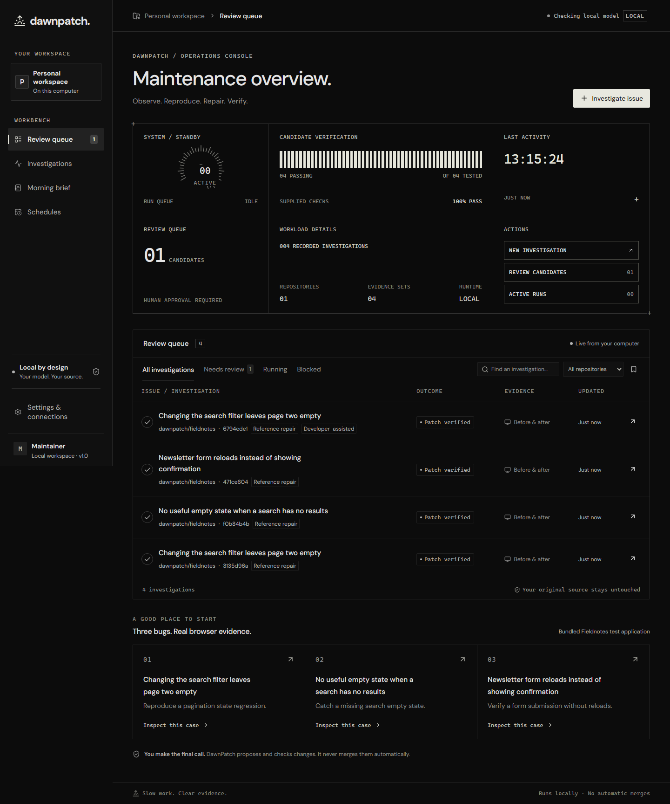

<div align="center">

# DawnPatch

### Go to sleep with issues. Wake up with evidence.

A local maintainer workbench for reproducing website bugs, preparing bounded patches, and reviewing what actually changed.

[](https://github.com/priy-anshugupta/DawnPatch/actions/workflows/verify.yml)


[](LICENSE)

[Quick start](#start) · [How it works](#how-it-works) · [Demo](#demo-and-screenshots) · [Testing](#checks) · [Setup checklist](REAL_TESTING_SETUP.md)

</div>

---

DawnPatch reproduces a reported website bug in local Chromium, captures screenshots and a browser trace, asks a local Gemma model for a bounded patch, applies it to a separate source copy, and replays the same checks. You review the evidence and diff. It never merges code automatically.

The application runs on your computer. There is no hosted dashboard, Auth0, Atlas, Browserbase, Render, or paid inference requirement. Optional online connections are SerpApi research, Sentry telemetry, and GitHub draft PR publication. Entire and Copilot/Actions are development-evidence integrations.



## Why DawnPatch

A bug report is rarely a complete investigation. Someone still has to reproduce the behavior, inspect the source, try a patch, and collect enough evidence for a reviewer. DawnPatch organizes that work into one inspectable case, while keeping the model and source processing on your computer.

- **Evidence before claims.** A passing baseline is reported as not reproduced. An invalid edit is rejected. A candidate must pass the same supplied browser checks before it can be marked verified.
- **Your checkout stays untouched.** Baseline and candidate source live in separate workspaces; repository builds use Docker rather than running package scripts on the host.
- **A maintainer workbench.** A dark instrument-style console presents queue status, browser evidence, code differences, checks, and explicit review actions.
- **Recoverable work.** SQLite checkpoints preserve progress, with an actual Temporal backend for durable execution and scheduling.
- **An honest handoff.** Recorded hypotheses, model usage, rejected attempts, and verification scope remain visible. You make the final decision.

## How it works

```text
Issue + reproduction steps
         │
         ▼
Copy authorized source → Reproduce in Chromium → Capture baseline evidence
                                                        │
                                      baseline fails a behavioral assertion
                                                        ▼
                                     Mastra workflow → local Gemma
                                                        │
                                                 validate exact edits
                                                        ▼
                                     isolated candidate → replay same checks
                                                        │
                                                        ▼
                                  evidence + diff + checks → maintainer review
                                                        │
                                          export patch / approve draft PR
```

If an action, build, provider, or model fails, DawnPatch records the error rather than presenting it as a successful repair. Verification means the **configured checks** passed; it is not a guarantee of general correctness.

## Demo and screenshots

[Watch the narrated SketchWild demonstration on YouTube](https://youtu.be/6MC6XOIzUgU)

- [Download the synchronized 1080p video](docs/demo/DawnPatch-SketchWild-1080p-synced.mp4).
- [Read the video notes and recording scope](docs/demo/VIDEO_NOTES.md).
- [Inspect the complete SketchWild test report](docs/SKETCHWILD_TEST_REPORT.md).
- [Review browser evidence](docs/screenshots/evidence-comparison.png).
- [Read measured build status](docs/BUILD_STATUS.md).
- [Read the challenge submission](post.md).

The latest recording demonstrates a deliberately introduced mission-filter regression in an isolated SketchWild checkout. Gemma 3:4b did not independently produce the successful correction. A developer submitted the exact source change, and DawnPatch built the candidate and passed the same eight browser steps, including the twenty-minute and location-filter regression checks. The UI and narration retain that provenance. A healthy upstream control passed without generating a patch.

> **Repair-quality limitation:** the observed Gemma attempts do not establish autonomous repair accuracy. Candidate verification covers the configured assertions and build. See the [test report](docs/SKETCHWILD_TEST_REPORT.md) for rejected proposals, the successful developer-assisted result, and validation scope.

The [earlier reference-fixture recording](docs/demo/dawnpatch-local-demo.webm) is historical and uses a known repair without model inference.

## Start

Requirements: Node.js 22.18 or newer (22.22+ recommended), npm, Git, and Ollama for actual model inference. Docker Desktop's Linux engine is required for React/Vite and Next.js repository builds. Static HTML fixtures do not need Docker.

```powershell
git clone https://github.com/priy-anshugupta/DawnPatch.git
cd DawnPatch
npm ci
npm run browser:install
Copy-Item .env.example .env
ollama pull gemma3:4b
npm run build
npm start
```

Choose the installed model in Settings. If using a different Gemma tag, set `GEMMA_MODEL` in `.env` before the first start. Model selection saved in the workbench persists in SQLite and takes precedence over the startup environment value.

On macOS/Linux, replace `Copy-Item .env.example .env` with `cp .env.example .env`. Set `GEMMA_MODEL=gemma3:4b` in `.env` to match the model downloaded above. Start Ollama before starting a model investigation. The 4B model was exercised in the recorded test; the successful candidate required a developer-assisted correction.

Open **http://127.0.0.1:4310**. For frontend development, `npm run dev` runs Vite on port 5173 and the API on 4310. A separate preview server binds to 4311 so untrusted preview scripts do not share the control API's origin.

Fonts are bundled locally. A working local Gemma run does not send prompts to a hosted model. The small 1B model can exercise inference but has produced invalid edits during testing; choose the 4B or another capable Gemma model suitable for your RAM. A passing fixture does not establish reliability on arbitrary codebases.

## First investigation

1. Choose one of the three Fieldnotes bugs: pagination state, missing search empty state, or newsletter form submission.
2. Keep **Local Gemma + Mastra** selected to test actual inference. Alternatively choose **Reference repair · no model** to test the browser pipeline with a known fix; these runs are permanently labeled.
3. Start the investigation. Inspect stage events rather than an indefinite thinking indicator.
4. Review the report, original baseline/candidate screenshots, assertion details, downloaded Playwright trace, unified diff, and checks.
5. Accept the candidate locally or export its report/patch. Local acceptance does not modify the original repository.

Baseline assertions must fail before a candidate can be verified. A failed navigation/click is an execution problem, not proof of the requested bug. Candidate verification covers only the supplied assertions and successful preview build, not all regression or security properties.

## Your repositories

Set `SOURCE_ROOTS` to directories whose repositories you authorize the app to read. Separate paths with `;` on Windows and `:` on Linux/macOS. Restart after changing environment variables.

```dotenv
SOURCE_ROOTS=C:\Projects;D:\OpenSource
```

Use **Investigate issue → Local repository**. Supply a clean Git checkout, select Static HTML, React/Vite, or Next.js, and define typed steps using `click`, `fill`, `select`, `text`, `visible`, `hidden`, and `count`. Include at least one assertion. Repository roots are validated using resolved paths; symlinks and sensitive/generated directories are excluded from copying. Source input is bounded to 1,500 files / 20 MB and model context to at most 25 source files / 12,000 characters by default. Use `SOURCE_CONTEXT_CHARS` to reduce the context budget and `GEMMA_TIMEOUT_MS` to configure the inference timeout on CPU-based laptops.

For Docker recipes, the app builds in an isolated source copy with capped memory, CPUs, PIDs, dropped capabilities, and no injected host credentials. Vite requires a lockfile, `npm ci`, `npm run build`, and its installed preview CLI; a package script named `preview` is not required. Next.js requires a lockfile, `npm run build`, and the installed Next CLI. The build container exposes a temporary loopback preview and is removed afterwards. Use repositories you trust; this is a local developer tool, not a hardened public multi-tenant execution service. Dependency installation requires registry access.

The model can edit at most five exact matching snippets in existing source files. Dependency manifests, VCS metadata, credentials, generated files, and build configuration cannot be changed. Source edits never touch the original checkout. Invalid edits receive at most one correction request. Original and rejected-run evidence are retained. If a model proposal fails, the developer-correction form accepts an exact reviewed edit and replays the saved checks. These runs are permanently labeled developer-assisted.

## Durable execution and scheduling

Default mode is a serial local queue with SQLite checkpoints. On API restart, interrupted local runs are requeued; persisted baseline/candidate evidence avoids repeating completed stages. The queue and schedules require the app to remain running. Daily schedules store an IANA timezone and show their next three occurrences. Missed local occurrences older than one minute are skipped, and an occurrence key prevents duplicate triggering.

For the **Temporal track**, use the actual Temporal backend:

```powershell
# Terminal 1, after installing the official Temporal CLI:
npm run temporal:dev
# Set WORKFLOW_ENGINE=temporal in .env, then start/restart the app.
# Terminal 2:
npm start
# Terminal 3:
npm run worker
```

No cloud account or Temporal API key is needed for the local service. The CLI helper uses `.dawnpatch/bin/temporal.exe` if present or a CLI on PATH. The service persists history in `.dawnpatch/temporal.db`; its UI is http://127.0.0.1:8233. Real Temporal schedules are used when that backend is selected. Do not switch backends with active schedules without deleting/recreating them under the selected backend.

Activities heartbeat; workflow retries recover from a terminated worker. Model/browser/network operations run in activities, not deterministic workflow code. Mastra owns typed context gathering and local-model analysis within the activity; it does not compete with Temporal for durable orchestration.

```powershell
# Requires the local API and Temporal service:
npx tsx scripts/temporal-recovery.ts
```

This test starts a dedicated worker, captures a baseline, kills that worker, restarts it, and checks that the original investigation completes. The test writes an evidence JSON file when it passes.

## Connections

| Connection | Setup | What it enables |
|---|---|---|
| Gemma / Ollama | Install/pull model; set its ID | Real local diagnosis and patch generation |
| Mastra | Installed through npm | Typed analysis workflow over the open model |
| Temporal | Local CLI service + worker | Durable execution and schedules |
| Sentry | Set `SENTRY_DSN` | Sanitized stage and model spans, token attributes, errors |
| SerpApi | Set `SERPAPI_API_KEY` | Opt-in documentation discovery |
| Entire | Supported CLI/agent setup | Recording development decisions; not a runtime dependency |
| Copilot / Actions | Actual development use or public Actions run | Reviewable development evidence |
| GitHub publication | Optional `GITHUB_TOKEN` with scoped repository access | Approved draft PRs |

The connection screen distinguishes ready, configured-but-unverified, and manual-evidence states. A configured Sentry DSN or search key alone does not establish successful integration. Exercise Test and a real investigation, then inspect the remote result.

SerpApi currently returns clearly labeled **search discovery snippets**. These are not independently fetched or version-verified documentation. The app must not present those snippets as authoritative citations. No search is performed unless explicitly enabled for the investigation.

For GitHub publication, the local repository must have a GitHub origin and its investigated SHA must still equal the remote default-branch SHA. The review dialog describes the write. Approval is tied to the candidate content hash and expires after 15 minutes. The server rehashes candidate files, reconciles an existing PR/branch, creates a draft PR, and never force-pushes or merges. Actual publication needs your token and authorized repository and is not exercised by fixture tests.

## Screens

- **Review queue:** outcomes, search, repository filters, saved views, and fixture launchers.
- **Investigation:** stage events, recorded observations, hypothesis, checks, model usage, and limitations.
- **Browser evidence:** original screenshots, comparison slider, assertion errors, console output, and trace download.
- **Patch:** portable unified diff and download.
- **Morning brief:** date-filtered investigation outcomes with Markdown export.
- **Schedules:** daily templates, IANA timezone, next-occurrence preview, pause/resume, and deletion.
- **Settings:** local runtime, model selection, connection checks, and authorized source roots.

## Checks

```powershell
npm run build
npm test
npm run test:e2e
```

Core and transport tests cover path/edit restrictions, unchanged-edit rejection, filename grounding, relevant source selection, isolated edits, stale approvals, cancellation, and schedule deduplication/timezones. Browser tests exercise the three known reference repairs, actual screenshot/trace downloads, diff export, mutation guards, desktop review, comparison, schedules, and settings on desktop. They do not pretend the model generated the reference fixes.

GitHub Actions configuration is in `.github/workflows/verify.yml`. It builds, runs core/browser tests, and uploads evidence. It must actually run in your repository before being cited as category evidence. No Copilot usage or Entire session is fabricated by this project.

## Local data and operational limits

All investigations, metadata, previews, browser traces, and screenshots live under ignored `.dawnpatch/`. The API binds to loopback, checks Host and Origin, and requires a custom header for mutations. Private previews have a separate origin; browser automation blocks cross-origin network requests. Avoid exposing the API over a public tunnel.

No automatic merges, issue closure, production writes, unrestricted remote execution, or claim of universal repair accuracy. Source files and browser evidence can contain sensitive information: review artifacts before sharing screenshots, traces, sessions, or reports. Traces are downloadable for local use; opening them in Playwright's trace viewer is optional.

See **REAL_TESTING_SETUP.md** for the exact account actions and **docs/BUILD_STATUS.md** for measured results and remaining external validation.

## Project structure

```text
src/                       React desktop workbench and console styling
shared/types.ts            Validated run, evidence, and schedule contracts
server/
  index.ts                 Loopback API and separate preview server
  runner.ts                Investigation stages and local checkpoint queue
  agent.ts                 Mastra workflow and Ollama inference
  browser.ts               Playwright reproduction and evidence capture
  workspaces.ts            Source isolation, edit policy, Docker previews, diffs
  db.ts                    SQLite records and ordered events
  scheduler.ts             Daily schedules and occurrence deduplication
  github.ts                Issue import, approval, and draft PR publication
  integrations.ts          Sentry, SerpApi, and connection health
  temporal/                Workflows, activities, client, and worker
tests/                     Core invariants and real browser integration tests
scripts/                   Demo recorder and worker-recovery test
docs/                      Screenshots, demo, evaluation evidence, build status
.github/workflows/         CI build, tests, and evidence uploads
```

## Troubleshooting

| Symptom | What to check |
|---|---|
| Local model is offline | Start Ollama, then check `ollama list`. The model ID in Settings must match an installed Gemma tag. |
| Model returns an invalid patch | Inspect the recorded failure. Try a capable local Gemma model and a smaller, clearer issue; never bypass exact-edit validation. |
| Laptop becomes sluggish | Close heavy applications, run one investigation at a time, and stop an unused model with `ollama stop <model>`. |
| Repository is rejected | Authorize its resolved parent in `SOURCE_ROOTS`, restart the app, and ensure the Git working tree is clean. |
| Vite/Next.js preview cannot start | Start Docker Desktop's Linux engine. Check the lockfile, recipe scripts, and dependency-network access. |
| Temporal work waits in the queue | Confirm the local service, namespace, matching task queue, and `npm run worker`; local SQLite mode is a separate backend. |
| Sentry/SerpApi shows setup needed | Add the appropriate value to ignored `.env`, restart, and use the connection test. Do not paste secrets into issues. |
| Port 4310 or 4311 is occupied | Stop the previous DawnPatch instance or set a free `PORT`; the preview uses the next port. Update frontend proxy/origin settings if changing development ports. |

## Contributing and attribution

Use a focused branch, explain the behavioral problem, and include the relevant checks and evidence. Read [CONTRIBUTING.md](CONTRIBUTING.md) before changing model, execution, or publication behavior. Keep `.env`, local source copies, databases, and private traces out of commits.

DawnPatch uses open-source libraries and local open-weight inference. Dependency code, fonts, and models retain their respective licenses and terms. The bundled Fieldnotes application is an original test fixture. The instrument-style interface takes visual inspiration from a user-supplied monochrome transfer-console reference. Development assistance was provided by Codex; no Copilot or Entire session is claimed without actual evidence.

Built for the [Hacktoberfest Week 3 Open-Source AI Challenge](https://dev.to/challenges/hacktoberfest-week3-2026-10-19). Eight partner-category entries are documented in the [submission](post.md); the [complete track audit](docs/submission/TRACK_AUDIT.md) distinguishes actual use from remaining session and tracing evidence.

## License

[MIT](LICENSE) for DawnPatch source. Review the selected Gemma model's terms separately before distribution or use.
