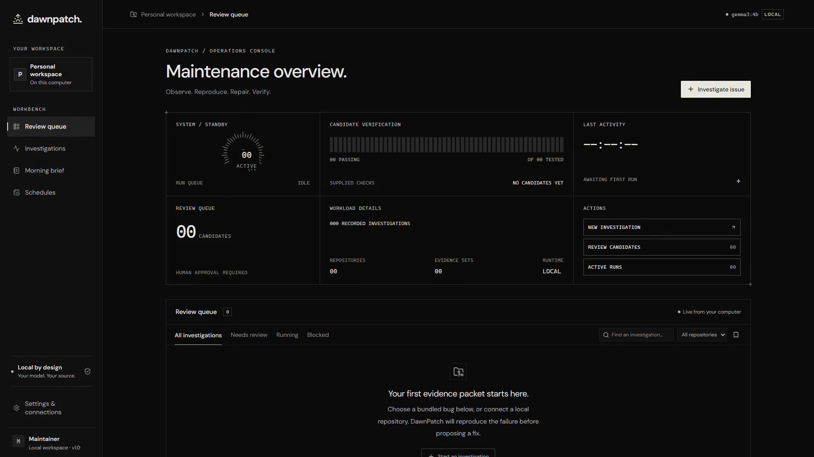
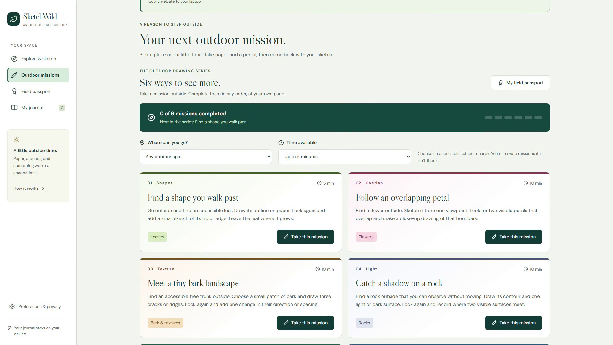
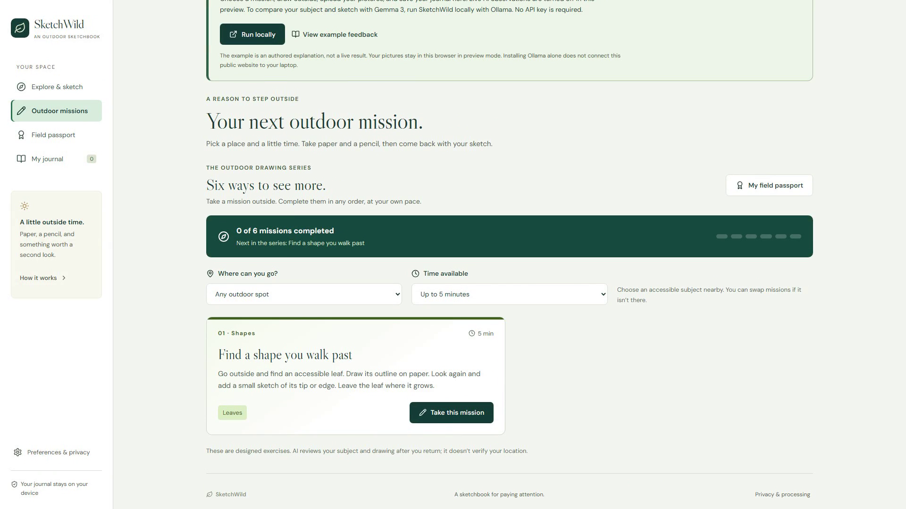
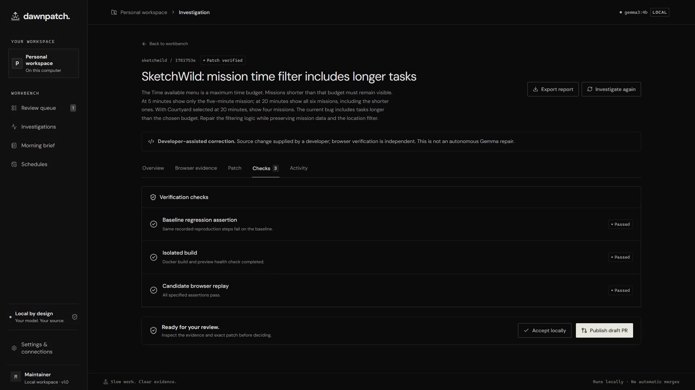
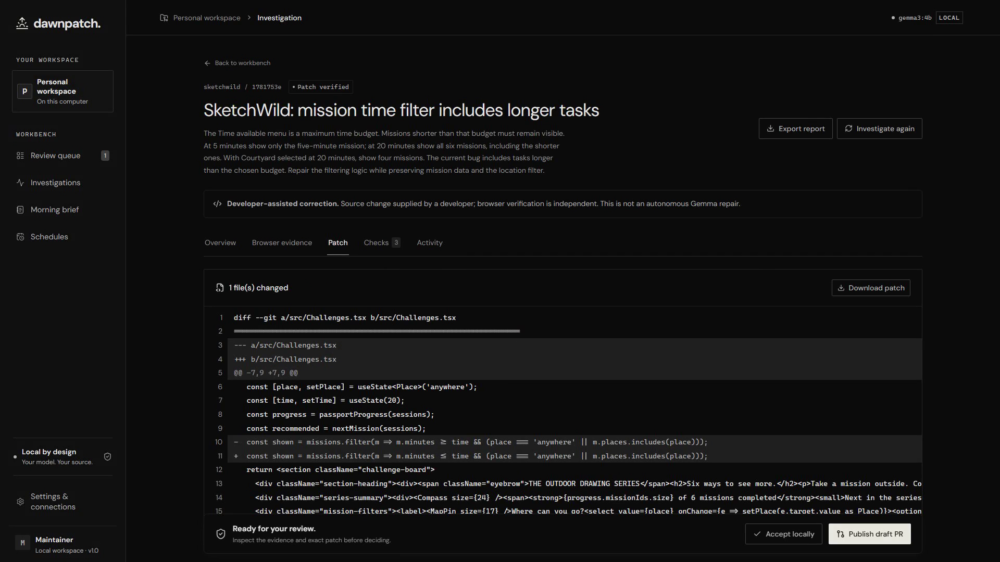
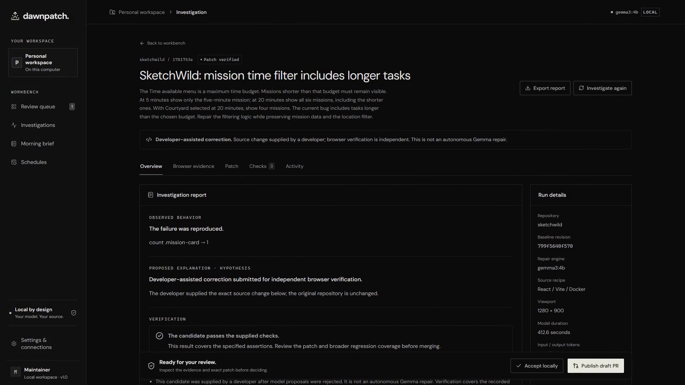
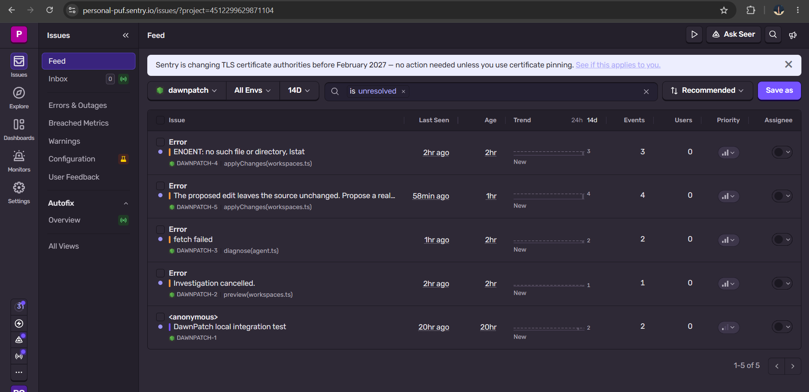
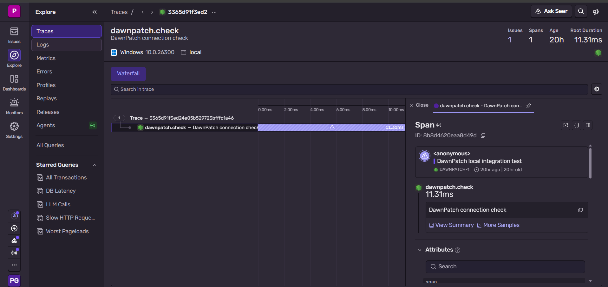

*This is a submission for the [Hacktoberfest Open-Source AI Challenge Week 3: Slow and Steady](https://dev.to/challenges/hacktoberfest-week3-2026-10-19).*

## What I Built

The part of fixing a website bug that I keep putting off is getting everything into one place: the reproduction steps, the failing screen, the relevant source, the proposed change, and proof that it helped.

I built **DawnPatch**, a local maintainer workbench that turns that process into a reviewable investigation.

Give it an authorized local repository, an issue, and browser steps with assertions. DawnPatch reproduces the behavior in Chromium, captures evidence, asks a local Gemma model for a small source change, and tests the candidate in a separate source copy. The maintainer gets a report, a diff, and the results of replaying the same checks.

Its rule is simple: **a proposed repair has to earn its passing result.**

*The desktop workbench: a quiet place to queue investigations and review their evidence.*

The workbench includes:

- An investigation queue with visible stages and recorded activity.
- Real browser reproduction, screenshots, and downloadable Playwright traces.
- Local Gemma analysis through a typed Mastra workflow.
- Bounded source edits with exact-match validation and rejection of unchanged proposals.
- Separate baseline and candidate workspaces, with build checks and browser replay.
- Evidence comparison, source diffs, reports, and patch exports.
- An explicit developer-correction path when the model needs help.
- Daily schedules, a morning brief, and Temporal workflows with worker-failure recovery.

The interface takes inspiration from instrument panels: dark surfaces, fine dividers, readable typography, and status information you can inspect. I wanted the work to be visible while a small local model takes its time.

## Demo

**[Watch the narrated desktop demonstration — approximately 3 minutes 15 seconds](https://youtu.be/6MC6XOIzUgU)**

DawnPatch runs locally; the video shows the actual website UI rather than a hosted application.

For the demonstration, I used my [SketchWild repository](https://github.com/priy-anshugupta/sketchwild) as the target. In an isolated test checkout, I deliberately reversed its mission-duration comparison. Selecting “Up to 5 minutes” then returned six missions instead of the expected one. This was a controlled regression for evaluating DawnPatch, not a newly discovered upstream bug.

*Before: the five-minute filter incorrectly includes longer missions.*

DawnPatch reproduced that failure. Gemma 3:4b did not produce a successful repair in the recorded investigation, so I supplied the exact correction through the developer-correction form. DawnPatch labels that origin explicitly, builds a separate candidate, and independently replays the browser steps.

*After the developer-assisted correction: only the expected five-minute mission remains.*

The complete replay checks more than that first screen: twenty minutes must show all six missions, and the courtyard filter must still show four. All eight recorded steps passed for the corrected candidate.

*Verification covers the failing baseline, an isolated build, and replay against the candidate.*

I also tested the healthy upstream revision. It passed the checks and finished without a patch. A passing website should not get a speculative “repair.”

Long inference waits and recording setup are cut from the video. The narration preserves the outcome: **this is a developer-assisted repair with automated verification, not a successful autonomous Gemma repair.**

## Code

**Repository: [priy-anshugupta/DawnPatch](https://github.com/priy-anshugupta/DawnPatch)**

The repository includes the application, setup instructions, automated checks, test evidence, and demo documentation. DawnPatch is MIT-licensed.

[Detailed SketchWild test report](https://github.com/priy-anshugupta/DawnPatch/blob/main/docs/SKETCHWILD_TEST_REPORT.md) · [Demo notes](https://github.com/priy-anshugupta/DawnPatch/blob/main/docs/demo/VIDEO_NOTES.md)

## How I Built It

The frontend uses **React, TypeScript, and Vite**. A local **Express** API coordinates investigations, while **SQLite** stores runs, ordered events, schedules, and checkpoints.

**Ollama runs the open-weight Gemma 3:4b model locally.** A Mastra workflow gathers a bounded selection of relevant source and asks for structured analysis and exact edits. The model's output is treated as a proposal that still needs validation.

**Playwright and Chromium provide the behavioral evidence.** Baseline and candidate use the same reproduction steps and assertions. For the SketchWild repository test, Docker builds and serves an isolated candidate; the original target repository is left unchanged.

The workflow is:

1. Prepare an isolated source copy.
2. Reproduce a failing behavioral assertion and save its evidence.
3. Gather relevant source and request a bounded model proposal.
4. Validate exact edits and build the candidate.
5. Replay the same browser checks.
6. Present the evidence and diff for human review.

*The reviewed change restores the maximum-duration comparison; its developer-assisted origin remains visible.*

One useful failure happened before the final recording: a model proposal used equality instead of a maximum-duration comparison. It satisfied the five-minute case but failed the twenty-minute check. DawnPatch kept the failed result instead of calling it verified. That test made the extra assertion worth having.

**Temporal powers the durable workflow backend.** I tested worker-failure recovery by terminating and restarting a worker during an investigation. The same investigation completed with its captured baseline preserved. The [recovery evidence](https://github.com/priy-anshugupta/DawnPatch/blob/main/docs/evidence/temporal-recovery.json) records the run and stage events. This test used a known fixture repair; the SketchWild video uses the local SQLite queue.

**SerpApi** provides optional documentation discovery. Search results are labeled as discovery snippets, and search was disabled for the recorded SketchWild investigation. **GitHub Actions** automates repository verification with a [public successful workflow run](https://github.com/priy-anshugupta/DawnPatch/actions/runs/39769781939). **ElevenLabs** generated the demo narration; it is a production tool for the video, not a dependency of the repair pipeline.

I also installed and configured **Entire** for Codex development-session capture. A shareable recorded session still needs to be attached before publication.

For the latest local build, **11 core/transport tests and 7 browser tests passed**, alongside TypeScript checking and the production build. Those checks cover edit validation, cancellation, correction provenance, replay, connection recovery, and desktop review flows. They do not establish that the model can autonomously fix arbitrary bugs.

## Why Does Open Innovation Matter?

Running Gemma locally lets me experiment with the agent while keeping model inference on my own machine. I can change the context budget, inspect the structured output, adjust the prompts, and choose a different installed model without rebuilding the browser-verification pipeline around a particular hosted provider.

That flexibility mattered during this build. A small model on a laptop was slow and sometimes wrong. Being able to inspect its proposals helped me improve filename grounding, reject no-change edits, and preserve a useful human-correction path.

Ollama, Mastra, Playwright, and Temporal also make the workflow inspectable. Contributors can examine how a source file was selected, why an edit was rejected, and which browser assertion failed.

A closed API could power a similar tool. The benefit here is control over the inference runtime and the workflow around it. Optional search, telemetry, GitHub publication, and narration services still need network access; local inference does not make every integration offline.

## The Lazy Payoff

I used DawnPatch this week to run the controlled SketchWild regression through reproduction, correction, and verification.

The payoff is fewer repeated steps: the browser records the failing behavior, the candidate gets its own build, the same assertions run again, and the report keeps the diff beside the evidence. I can spend my attention reviewing the result instead of assembling that evidence by hand.

*The handoff: observed behavior, repair provenance, verification, and the next review action.*

I have not measured a reliable time-saving percentage yet. The demonstrated benefit is repeatable evidence collection and a clearer review handoff, even when the model needs help.

## Monitoring and Debugging with Sentry

DawnPatch integrates Sentry to capture investigation errors and help diagnose failed runs. During testing, its Issues feed recorded model-request failures, rejected unchanged edits, and cancelled investigations. The instrumentation also defines spans for investigation stages and model calls, with sensitive-value redaction.

*Sentry received real DawnPatch testing events, including model-request failures and rejected unchanged source edits.*

*The dawnpatch.check trace confirms connectivity to Sentry. This connection check took 11.31 ms; it does not measure Gemma inference time. Model-call spans and token metrics remain unverified in the dashboard.*

## Prize Categories

- **Best Use of Gemma** — local Gemma 3:4b analysis and bounded patch proposals through Ollama.
- **Best Use of Mastra** — typed context-gathering and model-analysis workflow.
- **Best Use of Temporal** — durable investigation workflows with tested worker-failure recovery and preservation of the captured baseline. [Recovery evidence](https://github.com/priy-anshugupta/DawnPatch/blob/main/docs/evidence/temporal-recovery.json).
- **Best Use of SerpApi** — opt-in live documentation discovery.
- **Best Use of GitHub Copilot** — GitHub Actions automation for repository verification. [Successful workflow run](https://github.com/priy-anshugupta/DawnPatch/actions/runs/39769781939).
- **Best Use of ElevenLabs** — generated English narration for the demonstration video.
- **Best Use of Entire** — Entire CLI installed and configured for Codex development-session capture and checkpoints. **Shared agent-session link: add before publication.**
- **Best Use of Sentry Agent Tracing** — DawnPatch includes instrumentation for investigation stages and model calls, error capture, and sensitive-value redaction. The screenshots show received testing errors and the `dawnpatch.check` connection trace. Model-call traces and token metrics are not yet verified in the dashboard.
